# TARA 全网文通用模型 · 21 大垂直细分赛道全景归位与补全规划手册

> **项目定位**：打造中文网络文学工业级通用大模型微调底座（面向 7B / 14B / 32B 大参数）。
> **核心架构**：基于真实网文创作规律，确立 **21 个核心垂直细分赛道**，每赛道锁定 **10,000 条严格均衡的 SFT 训练样本**（全库总目标 **210,000 条**），彻底杜绝单一文风过拟合，打造具备全题材驾驭能力的“六边形全网文模型”。

---

## 目录
1. [21 大垂直细分赛道层级拓扑](#一21-大垂直细分赛道层级拓扑)
2. [现有 11 部经典神作归位与配额进度总表](#二现有-11-部经典神作归位与配额进度总表)
3. [21 赛道逐一拆解与缺口补全书单（2020~2024 十二天王与新晋白金/大神）](#三21-赛道逐一拆解与缺口补全书单20202024-十二天王与新晋白金大神)
4. [【重磅新增】2025 年起点 15 大现象级爆款新书深度盘点（含 2025 十二天王官方榜单）](#四2025-年起点-15-大现象级爆款新书深度盘点)
5. [【重磅新增】2026 年起点 15 大现象级热书盘点（含畅销/月票榜前列）](#五2026-年起点-15-大现象级热书盘点)
6. [分批导入实施策略与操作指南](#六分批导入实施策略与操作指南)

---

## 一、21 大垂直细分赛道层级拓扑

```mermaid
flowchart TD
    ROOT["TARA 21 大垂直细分赛道"] --> C1["仙侠修真板块"]
    ROOT --> C2["玄幻高武板块"]
    ROOT --> C3["奇幻西幻板块"]
    ROOT --> C4["悬疑惊悚板块"]
    ROOT --> C5["都市现实板块"]
    ROOT --> C6["历史军事板块"]
    ROOT --> C7["科幻末世板块"]
    ROOT --> C8["游戏泛二次元"]

    C1 --> T01["T01 凡人苟道稳健流"]
    C1 --> T02["T02 民俗诡异修仙流"]
    C1 --> T03["T03 家族宗门群像流"]
    C1 --> T04["T04 反套路爆笑仙侠"]

    C2 --> T05["T05 传统玄幻热血升级"]
    C2 --> T06["T06 现代高武万族战场"]
    C2 --> T07["T07 极道加点肌肉横推"]

    C3 --> T08["T08 西幻密教序列扮演"]
    C3 --> T09["T09 领地建设异界工业"]

    C4 --> T10["T10 规则怪谈绝望解密"]
    C4 --> T11["T11 惊悚密室系统探险"]

    C5 --> T12["T12 重生商战年代创业"]
    C5 --> T13["T13 硬核行业专业白描"]
    C5 --> T14["T14 都市异能吐槽搞怪"]

    C6 --> T15["T15 乱世军阀铁血争霸"]
    C6 --> T16["T16 考据内政制度改革"]

    C7 --> T17["T17 赛博朋克双界穿梭"]
    C7 --> T18["T18 硬核科技学霸工业"]

    C8 --> T19["T19 第四天灾反向背刺"]
    C8 --> T20["T20 诸天无限独狼乐园"]
    C8 --> T21["T21 原生轻小说修罗场"]
```



---

## 二、现有 11 部经典神作归位与配额进度总表

> [!NOTE]
> - **配额规划**：每个细分赛道分配 **10,000 条 SFT 样本**（折合 **2,000 个 10% 穿透抽样章节**）。
> - **现有基础**：首批 11 部经典神作已全部完成逆向切片与四层穿透注入，累计贡献 **6,110 条 SFT**，已精准归入 8 条赛道。

| 赛道编号 | 细分赛道名称 | 归属母分类 | 目标配额 | 现有 SFT | 现存归位图书 | 缺口 SFT | 当前状态 |
| :---: | :--- | :---: | :---: | :---: | :--- | :---: | :---: |
| **T01** | **凡人苟道 / 稳健长生流** | 仙侠修真 | 10,000 | 1,515 | 《凡人修仙传》(1170), 《稳健师兄》(345) | 8,485 | 基础已建 |
| **T02** | **民俗志怪 / 诡异修仙流** | 仙侠修真 | 10,000 | 0 | (暂无) | 10,000 | 🔴 空白急需 |
| **T03** | **家族宗门 / 群像残酷流** | 仙侠修真 | 10,000 | 0 | (暂无) | 10,000 | 🔴 空白急需 |
| **T04** | **反套路 / 爆笑迪化仙侠** | 仙侠修真 | 10,000 | 0 | (暂无) | 10,000 | 🔴 空白急需 |
| **T05** | **传统玄幻 / 热血升级流** | 玄幻高武 | 10,000 | 755 | 《斗破苍穹》(755) | 9,245 | 基础已建 |
| **T06** | **现代高武 / 灵气复苏万族流** | 玄幻高武 | 10,000 | 0 | (暂无) | 10,000 | 🔴 空白急需 |
| **T07** | **极道加点 / 肌肉横推流** | 玄幻高武 | 10,000 | 0 | (暂无) | 10,000 | 🔴 空白急需 |
| **T08** | **西幻序列 / 密教扮演流** | 奇幻西幻 | 10,000 | 675 | 《诡秘之主》(675) | 9,325 | 基础已建 |
| **T09** | **领地建设 / 异界种田流** | 奇幻西幻 | 10,000 | 0 | (暂无) | 10,000 | 🔴 空白急需 |
| **T10** | **规则怪谈 / 绝望解密流** | 悬疑惊悚 | 10,000 | 750 | 《神秘复苏》(750) | 9,250 | 基础已建 |
| **T11** | **惊悚探险 / 密室经营流** | 悬疑惊悚 | 10,000 | 625 | 《盗墓笔记》(265), 《冒险屋》(360) | 9,375 | 基础已建 |
| **T12** | **重生创业 / 年代商战流** | 都市现实 | 10,000 | 520 | 《我真没想重生啊》(520) | 9,480 | 基础已建 |
| **T13** | **硬核行业 / 职业白描流** | 都市现实 | 10,000 | 0 | (暂无) | 10,000 | 🔴 空白急需 |
| **T14** | **都市异能 / 吐槽搞怪流** | 都市现实 | 10,000 | 630 | 《大王饶命》(630) | 9,370 | 基础已建 |
| **T15** | **乱世军阀 / 铁血争霸流** | 历史军事 | 10,000 | 0 | (暂无) | 10,000 | 🔴 空白急需 |
| **T16** | **考据内政 / 制度改革流** | 历史军事 | 10,000 | 640 | 《绍宋》(200), 《大奉打更人》(440) | 9,360 | 基础已建 |
| **T17** | **赛博朋克 / 双界穿梭流** | 科幻末世 | 10,000 | 0 | (暂无) | 10,000 | 🔴 空白急需 |
| **T18** | **硬核科技 / 学霸工业流** | 科幻末世 | 10,000 | 0 | (暂无) | 10,000 | 🔴 空白急需 |
| **T19** | **第四天灾 / 反向背刺流** | 游戏二次元 | 10,000 | 0 | (暂无) | 10,000 | 🔴 空白急需 |
| **T20** | **诸天无限 / 独狼乐园流** | 游戏二次元 | 10,000 | 0 | (暂无) | 10,000 | 🔴 空白急需 |
| **T21** | **原生轻小说 / 恋爱修罗场流** | 游戏二次元 | 10,000 | 0 | (暂无) | 10,000 | 🔴 空白急需 |
| **总计** | **21 大独立赛道** | **全网文** | **210,000** | **6,110** | **已处理 11 部神作** | **203,890** | **全面启动扩充** |

---

## 三、21 赛道逐一拆解与缺口补全书单（2020~2024 十二天王与新晋白金/大神）

### 【板块一：仙侠修真】

#### T01 凡人苟道 / 稳健长生流
- **叙事机制**：杀人夺宝、步步为营、底牌保留、因果戒律、反盲目装逼。
- **现存归位**：《凡人修仙传》（1,170 条）、《我师兄实在太稳健了》（345 条）
- **定向补全新书**：
  1. **《苟在妖武乱世修仙》** (文抄公) —— 两界穿梭稳健长生天花板，主世界唯唯诺诺，异界重拳出击。
  2. **《我有一个修仙世界》** (纯九莲宝灯，2024 十二天王) —— 现代社会与修仙位面双向资源倒卖与长生流。

#### T02 民俗志怪 / 诡异克苏鲁修仙（🔴 空白急需）
- **叙事机制**：认知错乱、真假虚实分裂、民俗禁忌仪式、不可名状的大道异化。
- **定向补全新书**：
  1. **《道诡异仙》** (狐尾的笔，2022天王/2024白金) —— 东方克苏鲁破圈第一神作，“妈，我分不清”。
  2. **《黄昏分界》** (黑山老鬼，2024白金) —— 东北五大仙、出马走山人、中式废土民俗压迫感神作。
  3. **《长生志异》** (真愚老人) —— 纯正志怪道法，光怪陆离的诡谲修仙。
  4. **《俗主》** (南腔北调，2022天王) —— 民俗煞气与俗世谋生。

#### T03 家族宗门 / 群像残酷流（🔴 空白急需）
- **叙事机制**：去个人英雄主义、代际血脉传承、资源匮乏求存、宗族壮烈伏笔。
- **定向补全新书**：
  1. **《玄鉴仙族》** (季越人，2023天王/2024大神) —— 00后天才写就的家族修仙群像天花板，残酷底层修真史诗。
  2. **《仙工开物》** (蛊真人，2024天王) —— 机关傀儡宗门崛起与高维智斗。
  3. **《我本无意成仙》** (金色茉莉花，2023天王) —— 山野散仙漫游，温润非遗民俗风。

#### T04 反套路 / 爆笑迪化仙侠（🔴 空白急需）
- **叙事机制**：解构传统修仙套路、主角脑回路清奇、全员脑补迪化、高频相声包袱。
- **定向补全新书**：
  1. **《谁让他修仙的！》** (最白的乌鸦，2023天王/2025白金) —— 起点仙侠长期畅销榜一，反套路神展开。
  2. **《我不可能是剑神》** (裴不了，2021天王) —— 情景喜剧式十里坡剑神，爆笑无厘头开山作之一。
  3. **《我用闲书成圣人》** (出走八万里，2022天王) —— 专业编剧执笔，儒道文气杀敌流。

---

### 【板块二：玄幻高武】

#### T05 传统玄幻 / 热血升级打脸流
- **叙事机制**：逆境反杀、三十年河东、境界压制、当众显圣、情绪大开大合。
- **现存归位**：《斗破苍穹》（755 条）
- **定向补全新书**：
  1. **《万世之名》** (古羲，2024天王) —— 原名《从婴儿开始入道》，多世转生与极快节奏升级。
  2. **《赤心巡天》** (情何以甚，2022天王/2024大神，大英图书馆收录) —— 宏大世界观、正统武斗与家国大义。

#### T06 现代高武 / 灵气复苏万族流（🔴 空白急需）
- **叙事机制**：高考武科、地窟前线、万族战场、军武战阵热血家国情怀。
- **定向补全新书**：
  1. **《高武纪元》/《渊天尊》** (烽仙，2024大神) —— 现代高武硬派热血，战斗节奏极为凌厉。
  2. **《神话纪元，我进化成了恒星级巨兽》** (群玉山头见，2023天王) —— 本体武道+巨兽分身吞噬进化的视听盛宴。
  3. **《全球高武》** (老鹰吃小鸡) —— 现代高武地窟流奠基作。

#### T07 极道加点 / 肌肉蛮霸横推流（🔴 空白急需）
- **叙事机制**：深蓝加点、绝对肉身蛮力、横推神鬼、杀伐果断暴力美学。
- **定向补全新书**：
  1. **《从斩妖除魔开始长生不死》** (陆月十九，2024天王) —— 爆杀流斩妖除魔，纯粹暴力横推，节奏快到飞起。
  2. **《道爷要飞升》** (裴屠狗，2023天王/2024大神) —— 大罗推演、肉身气血大圆满硬汉流。
  3. **《极道天魔》** (滚开，2024白金) —— “深蓝加点”流鼻祖，肌肉暴徒碾碎一切诡异。

---

### 【板块三：奇幻西幻】

#### T08 西幻序列 / 密教扮演流
- **叙事机制**：序列魔药途径、扮演法消化、仪式神秘学、维多利亚时代风貌。
- **现存归位**：《诡秘之主》（675 条）
- **定向补全新书**：
  1. **《宿命之环》** (爱潜水的乌贼) —— 诡秘续作，西幻猎人途径、宿命之神与密教仪式。
  2. **《国王》** (新海月1，2023天王) —— 中世纪正统贵族领主分封与权术战争。

#### T09 领地建设 / 异界工业种田流（🔴 空白急需）
- **叙事机制**：现代工业科技树跨界、魔导工业革命、制度改革与文明攀升。
- **定向补全新书**：
  1. **《黎明之剑》** (远瞳，起点白金) —— 魔导工业革命、宏大世界观基建与深空文明解密天花板。
  2. **《放开那个女巫》** (二目) —— 工业科技树改造中世纪奇幻社会的教科书。

---

### 【板块四：悬疑惊悚】

#### T10 规则怪谈 / 绝望解密流
- **叙事机制**：鬼无法被杀死、规律洞察、绝望死局逻辑求生、冷酷心理博弈。
- **现存归位**：《神秘复苏》（750 条）
- **定向补全新书**：
  1. **《从红月开始》** (黑山老鬼，2024白金) —— 精神异化废土、家庭幻觉与疯癫规则怪谈。
  2. **《地狱公寓》** (黑色火种) —— 纯粹无解规则血字试炼、绝对冷静逻辑推理破局。

#### T11 惊悚探险 / 密室系统经营流
- **叙事机制**：古墓机关风水、凶宅探案试炼、心跳反差幽默、恐怖道具经营。
- **现存归位**：《盗墓笔记》（265 条）、《我有一座冒险屋》（360 条）
- **定向补全新书**：
  1. **《我的治愈系游戏》** (我会修空调，2023白金) —— 深层心理悬疑与都市怪谈游戏。
  2. **《深夜书屋》** (纯洁滴小龙，2023白金) —— 都市灵异夜行、鬼差温情与幽默讽刺。

---

### 【板块五：都市现实】

#### T12 重生创业 / 年代商战流
- **叙事机制**：时代浪潮掘金、信息差降维、修罗场情感拉扯、江湖世故人情。
- **现存归位**：《我真没想重生啊》（520 条）
- **定向补全新书**：
  1. **《重回1982小渔村》** (米饭的米，2024天王) —— 改革开放初沿海渔民赶海发家，纯朴扎实的时代浪潮。
  2. **《重生之出人头地》** (闹闹不爱哭) —— 港岛五六十年代商业枭雄、黑白博弈教科书。

#### T13 硬核行业 / 职业白描流（🔴 空白急需）
- **叙事机制**：专业壁垒打破、手术室/法医刑侦严谨白描、凡尔赛技术装逼。
- **定向补全新书**：
  1. **《大医凌然》** (志鸟村，2023白金，大英图书馆收录) —— 医学外科微观白描天花板，凡尔赛天才幽默。
  2. **《国民法医》** (志鸟村) —— 刑事法医痕迹检验、现场还原与硬核破案。
  3. **《当医生开了外挂》** (手握寸关尺，2020天王) —— 急诊科高压快节奏救援。

#### T14 都市异能 / 吐槽搞怪流
- **叙事机制**：收集负面情绪、毒舌嘴贱、现代都市超能觉醒、爆笑反差日常。
- **现存归位**：《大王饶命》（630 条）
- **定向补全新书**：
  1. **《我的超能力每周刷新》** (一片雪饼，2024天王) —— 搞怪无厘头超能力与温馨校园生活，对白极其幽默。
  2. **《不许没收我的人籍》** (可怜的夕夕，2023天王) —— 异能二次元日常，脑洞大开的幽默风趣。

---

### 【板块六：历史军事】

#### T15 乱世军阀 / 铁血争霸流（🔴 空白急需）
- **叙事机制**：汉末隋末乱世开局、沙盘军阵战法、武将枭雄对决、豪迈军纪与英雄气。
- **定向补全新书**：
  1. **《覆汉》** (榴弹怕水) —— 汉末三国军事争霸天花板，沙盘推演、英雄义气与政治算计。
  2. **《黜龙》** (榴弹怕水) —— 隋末义军起义，群雄逐鹿的沧桑骨力。
  3. **《晋末长剑》** (孤独麦客，2024天王) —— 五胡乱华铁血军阵对抗、步步为营光复中原。

#### T16 考据内政 / 制度改革流
- **叙事机制**：两宋晚明制度考据、皇帝与权臣过招、财政官制革新、现代意识撞击皇权。
- **现存归位**：《绍宋》（200 条）、《大奉打更人》（440 条）
- **定向补全新书**：
  1. **《北宋穿越指南》** (王梓钧) —— 宋末制度、经济考据极深，现代激进改革与封建权贵碰撞。
  2. **《满唐华彩》** (怪诞的表哥，2024大神) —— 盛唐开元天宝之交文风考究，极富唐韵。
  3. **《大明国师》** (西湖遇雨，2023天王) —— 洪武君臣角力、改革明朝命运。
  4. **《万历明君》** (鹤招，2024天王) —— 万历朝财政整顿与远洋扩张。

---

### 【板块七：科幻末世】

#### T17 赛博朋克 / 双界穿梭流（🔴 空白急需）
- **叙事机制**：财阀垄断赛博、义体改造与武道、现实与虚拟/异世界双重博弈。
- **定向补全新书**：
  1. **《夜的命名术》** (会说话的肘子，起点白金) —— 赛博朋克财阀都市与表世界穿梭，极其强烈的情绪煽动力。
  2. **《赛博英雄传》** (吾道长不孤) —— 义体算法与侠客精神碰撞，语言风格深邃硬派。

#### T18 硬核科技 / 学霸工业流（🔴 空白急需）
- **叙事机制**：科学猜想证明、高端制造受限突破、冷核聚变、跨时空科技俱乐部。
- **定向补全新书**：
  1. **《天才俱乐部》** (城城与蝉，2024天王第一，第35届中国科幻银河奖，均订10万+) —— 时间循环、梦境俱乐部硬核博弈。
  2. **《学霸的黑科技系统》** (晨星LL，2023白金) —— 学术攻坚、工业受限突破、学霸系统流奠基之作。
  3. **《最终神职》** (拓跋狗蛋，2023天王) —— 肉身进化与科幻职业树升级。

---

### 【板块八：游戏二次元】

#### T19 第四天灾 / 反向背刺流（🔴 空白急需）
- **叙事机制**：召唤现代沙雕玩家当苦力、反向投资一心亏钱被全员背刺疯狂盈利。
- **定向补全新书**：
  1. **《亏成首富从游戏开始》** (青衫取醉，2023白金) —— 反向商业投资背刺喜剧第一名，逻辑闭环极强。
  2. **《这游戏也太真实了》** (晨星LL，2023白金) —— 废土硬核玩家基建、第四天灾生态白描。
  3. **《地下城玩家》** (蓝白的天) —— 沙雕玩家异界搬砖第四天灾开山鼻祖。
  4. **《说好制作烂游戏，泰坦陨落什么鬼》** (布洛芬战士，2023天王) —— 游戏开发制作情绪流。

#### T20 诸天无限 / 独狼乐园流（🔴 空白急需）
- **叙事机制**：空间乐园试炼、独狼近战斩击、万界副本攻略、冷酷力量成长。
- **定向补全新书**：
  1. **《从姑获鸟开始》** (活儿该，起点大神) —— 现代诸天流天花板，民俗国术、九品中正，文字极其干练硬派。
  2. **《轮回乐园》** (那一只蚊子) —— 独狼猎杀、杀伐果断、近战肉搏与数值成长的极致爽感。
  3. **《超神机械师》** (齐佩甲，起点大神) —— NPC 降维割韭菜、星际机械军团宇宙争霸神作。

#### T21 原生轻小说 / 恋爱修罗场流（🔴 空白急需）
- **叙事机制**：微表情心理拉扯、嘴硬傲娇、异界羁绊与修罗场、青春情感轻喜剧。
- **定向补全新书**：
  1. **《都重生了谁谈恋爱啊》** (错哪儿了，2023天王/2024大神) —— 当代大学生恋爱轻喜剧爆款第一。
  2. **《术师手册》** (听日，2021天王) —— 异界监狱越狱、群像恋爱修罗场、深度羁绊。
  3. **《我的女友是恶劣大小姐》** (李童) —— 日轻恋爱天花板，微表情与傲娇心理拉扯极致。

---

## 四、2025 年起点 15 大现象级爆款新书深度盘点

> 2025 年为起点“史上最年轻十二天王”大换代之年，95后、00后作者全面接管潮流，抽象反套路、轻小说化与多元跨界（玄幻+悬疑、西幻+种田）成为绝对主导。

| 序号 | 书名 | 作者 | 2025 官方荣誉 / 榜单定位 | 对应细分赛道 | 核心创新看点与文学价值 |
| :---: | :--- | :--- | :--- | :---: | :--- |
| **01** | **《苟在初圣魔门当人材》** | 鹤守月满池 | **2025 十二天王第一**，165天破10万均订，月票霸榜 | **T01 凡人苟道 / 魔修长生** | 异宝“百世书”复活重开，在黑暗魔门将苟道与悬疑推理发挥到极致，打破近年最快10万均订纪录。 |
| **02** | **《捞尸人》** | 纯洁滴小龙 | 2025年度现象级都市灵异，打破多项单月月票纪录 | **T10 规则怪谈 / 传统灵异** | 纯正黄河捞尸民俗、生死渡化与压迫感，传统灵异在现代网文环境下的巅峰爆发。 |
| **03** | **《普罗之主》** | 沙拉古斯 | **2025 十二天王**，开创“东方蒸汽道门”新潮流 | **T02 民俗诡异 / 蒸汽克苏鲁** | 独特的“东方蒸汽朋克+道门怪谈”世界观构建，冷峻的工业美学与诡谲神秘感并存。 |
| **04** | **《这个地下城长蘑菇了》** | 生吃菌子 | **2025 十二天王**，轻小说与原生幻想大爆款 | **T19 第四天灾 / 异界种田** | “菌类主角”独特非人视角切入地下城，幽默风趣、全员迪化的轻喜剧神作。 |
| **05** | **《从水猴子开始成神》** | 甲壳蚁 | **2025 十二天王（00后新锐）**，淮涡泽神水兽流 | **T06 现代高武 / 异兽神道** | 底层渔民获泽鼎垂青，从一头水猴子开始吞噬进化，统御水兽成就“淮涡之君”，画面感极强。 |
| **06** | **《我的化身正在成为最终BOSS》** | 汐尺 | **2025 十二天王（00后新锐）**，幕后黑手异能流 | **T14 都市异能 / 幕后黑手** | 角色扮演、开小号分身伪装反派BOSS、幕后操盘与都市超凡解密，布局极其深远。 |
| **07** | **《刚准备高考，离婚逆袭系统来了》** | 七月封阳 | **2025 十二天王**，都市校园恋爱轻喜剧 | **T21 原生轻小说 / 青春日常** | 错配系统反差萌，精准切中年轻读者笑点与青春校园情感拉扯，对白梗度极高。 |
| **08** | **《哥布林重度依赖》** | 絮理 | **2025 十二天王（00后女作家）**，西幻底层冒险 | **T21 轻小说 / 西幻冒险** | 文笔清新有质感，描写异世界底层微末生命的温情、羁绊与冒险，轻快与厚重并存。 |
| **09** | **《冬日重现》** | 雪梨炖茶 | **2025 十二天王（00后新锐）**，青春悬疑时间循环 | **T10 规则怪谈 / 悬疑循环** | 精巧的时间循环、硬核线索拼图与青涩微苦恋爱日常交织，叙事张力极强。 |
| **10** | **《以一龙之力打倒整个世界！》** | 唐宋元明氢 | **2025 十二天王**，硬核巨龙文明科幻 | **T18 硬核科技 / 异界文明** | 摆脱人类视角，描写巨龙文明科技演进、战争哲学与力量思辨，格局宏大冷酷。 |
| **11** | **《多我一个后富怎么了》** | 渔雪 | **2025 十二天王**，年代商战致富流 | **T12 重生创业 / 年代商战** | 80年代商战风口刻画极为逼真，市井烟火气与时代浪潮人情世故拉满。 |
| **12** | **《仙道尽头》** | 怕辣的红椒 | **2025 十二天王**，反套路修仙新概念 | **T04 反套路 / 爆笑仙侠** | 颠覆传统修真因果体系，剧情反转不断，对传统仙侠设定进行了彻底解构。 |
| **13** | **《今天毁灭世界了吗？》** | 如星也 | **2025 十二天王**，时空幻想脑洞科幻 | **T18 硬核科技 / 时空解密** | 宏大时空架构下的危机推演，将科幻灾难与幽默脑洞结合得天衣无缝。 |
| **14** | **《1984：从川菜馆开始》** | 轻语江湖 | 2025 都市生活/美食流月票黑马爆款 | **T12 重生年代 / 行业日常** | 改革开放初期川味美食与胡同烟火人情，文字极其温润治愈，生活细节满分。 |
| **15** | **《大明王朝1627》** | 一橛柴 | 2025 历史架空类高口碑考据之作 | **T16 考据内政 / 制度改革** | 崇祯元年开局，极其扎实的晚明财政、辽饷、党争与军队制度推演。 |

---

## 五、2026 年起点 15 大现象级热书盘点

> 2026 年迎来白金大神集体大作爆发（乌贼国风新宇宙、辰东玄幻统御、肘子古典武侠）与中坚实力派（季越人、田隶、熊狼狗）的巅峰对决。

| 序号 | 书名 | 作者 | 2026 市场地位 / 榜单战绩 | 对应细分赛道 | 核心创新看点与文学价值 |
| :---: | :--- | :--- | :--- | :---: | :--- |
| **01** | **《剑烛大荒》** | 爱潜水的乌贼 | **2026年5月发布首日登顶全网畅销榜**，全球同步连载 | **T05 传统玄幻 / 山海神话** | 跳出西幻，取材《山海经》颛顼绝地天通，三十岁佛系穿越者在后山海蛮荒江湖的宏大史诗。 |
| **02** | **《夜无疆》** | 辰东 | **2026 长期稳居起点月票榜榜首**，玄幻断层顶流 | **T05 传统玄幻 / 秘境争霸** | 辰东标志性宏大世界观、星空彼岸秘境与极其热血的白金级大场面调度。 |
| **03** | **《青山》** | 会说话的肘子 | **2026 男生月票榜长期前十**，古典侠气大作 | **T05 传统玄幻 / 东方侠气** | 告别都市高武，转写“天下最后一分侠气”的古典东方江湖，人物塑造有极高风骨。 |
| **04** | **《武道！》** | 田隶 | **2026 高武品类杀入月票榜前三**，硬核武斗爽文 | **T06 现代高武 / 港风江湖** | 港式九龙城寨暗流与高武超凡体系碰撞，拳拳到肉、张力极强的硬核近战。 |
| **05** | **《让仙门再次伟大》** | 鹤守月满池 | 2026 畅销榜常驻热门，宗门经营新神作 | **T03 家族宗门 / 反套路群像** | 《魔门人材》作者延续神作水准，将无厘头幽默、宗门扩张与宗派内卷写得极其出彩。 |
| **06** | **《没钱修什么仙？》** | 熊狼狗 | 2026 仙侠月票榜前列，黑色幽默复仇爽文 | **T04 反套路 / 资本修仙** | 将现代金融、负债、资本异化融入修仙世界，脑洞奇大，情绪张力爆棚。 |
| **07** | **《神的模仿犯》** | 青衫取醉 | 2026 悬疑解谜与高智商心理博弈力作 | **T10 规则怪谈 / 心理博弈** | 《亏成首富》作者转型硬核悬疑脑洞，密闭空间心理推演与高智商罪案对抗。 |
| **08** | **《大耳贼刘备》** | 十二楼月明 | 2026 历史三国争霸高口碑畅销佳作 | **T15 乱世军阀 / 铁血争霸** | 从刘备第一视角切入，汉末群雄逐鹿、政治算计与豪杰义气描写极具骨力。 |
| **09** | **《我在俄国当文豪》** | 卡拉马佐夫 | 2026 文娱跨界现象级神书 | **T13 硬核行业 / 文豪文娱** | 严肃俄国文学、托尔斯泰时代历史风貌与现代网文爽感结合，文笔惊艳绝伦。 |
| **10** | **《原来我是仙道天骄》** | 醋六香 | 2026 轻松向幻想修仙黑马爆款 | **T04 反套路 / 迪化爆笑** | 经典的误会迪化流升级版，反差装逼节奏把控极稳。 |
| **11** | **《深空余烬》** | 远瞳 | 2026 科幻/异界探险长青畅销神作 | **T09 领地建设 / 异界文明** | 幽灵船长、失落之海与文明废墟探索，远瞳式幽默与宏大设定的典范。 |
| **12** | **《两界修真帝国》** | 纯九莲宝灯 | 2026 现代科技降维打击修真界力作 | **T01 凡人苟道 / 两界倒卖** | 现代重工业体系与古代修真宗门的贸易倾销与制度征服。 |
| **13** | **《赛博武道纪元》** | 吾道长不孤 | 2026 硬核赛博朋克与传统武道碰撞神作 | **T17 赛博双界 / 义体武道** | 赛博神经电缆、脑机接口与内家真气算法融合，硬核武德与反抗精神。 |
| **14** | **《红月降临：我有一座判官殿》** | 黑山老鬼 | 2026 中式民俗与阴司绝望求生神作 | **T02 民俗诡异 / 规则怪谈** | 现代都市诡异入侵，地府阴司规则重构，惊悚悬疑氛围拉满。 |
| **15** | **《领主：开局建造机械天庭》** | 奇幻新锐 | 2026 第四天灾与领地基建现象级爆款 | **T19 第四天灾 / 机械神庭** | 机械工程学与神话仙神阵法结合，玩家公会征伐万界的群像狂欢。 |

---

## 六、分批导入实施策略与操作指南

### 1. 第一批优先扫荡清单（最急需补全的 10 本核心空白赛道神作）

> [!TIP]
> 建议按以下优先级优先下载 `.epub` 并放入工程根目录，可立即点亮目前尚处空白的关键赛道：

1. **T02 民俗诡异**：《道诡异仙》(狐尾的笔)
2. **T03 家族宗门**：《玄鉴仙族》(季越人)
3. **T04 反套路仙侠**：《谁让他修仙的！》(最白的乌鸦)
4. **T01 凡人魔门**：《苟在初圣魔门当人材》(鹤守月满池，2025第一爆款)
5. **T10 悬疑灵异**：《捞尸人》(纯洁滴小龙，2025悬疑第一)
6. **T18 科幻解密**：《天才俱乐部》(城城与蝉，银河奖均订10万)
7. **T17 赛博双界**：《夜的命名术》(会说话的肘子)
8. **T19 反向背刺**：《亏成首富从游戏开始》(青衫取醉)
9. **T20 诸天无限**：《从姑获鸟开始》(活儿该)
10. **T13 硬核职业**：《大医凌然》(志鸟村)

### 2. 自动化执行机制（导入即自动入库）
将下载好的 `.epub` 放入工程根目录后，直接运行通用调度引擎：
```bash
# 单本极速入库（自动 10% 穿透抽样、DPO 盲写、SFT 格式化与融合）
.venv/bin/python3 -u src/process_single_novel.py "书名.epub" --ratio 0.1 --threads 8
```
入库后图书自动归档至 `processed_books/`，各赛道 SFT 进度将在 `config/tracks.json` 自动更新统计！
